<div align="center">

# 🌿 Green Hydrogen Platform

**A full-stack digital control & monitoring platform for renewable-to-hydrogen production facilities**

[](https://react.dev/)
[](https://vitejs.dev/)
[](https://expressjs.com/)
[](https://www.mongodb.com/)
[](https://nodejs.org/)

</div>

---

## 📋 Table of Contents

1. [Executive Summary](#executive-summary)
2. [System Architecture](#system-architecture)
3. [Data Flow](#data-flow)
4. [Technology Stack](#technology-stack)
5. [Repository Structure](#repository-structure)
6. [LP Optimization Engine](#lp-optimization-engine)
7. [Authentication & Role System](#authentication--role-system)
8. [API Reference](#api-reference)
9. [Frontend Pages](#frontend-pages)
10. [MongoDB Data Models](#mongodb-data-models)
11. [Environment Configuration](#environment-configuration)
12. [Getting Started](#getting-started)
13. [Scenario Presets](#scenario-presets)
14. [Roadmap](#roadmap)

---

## Executive Summary

The **Green Hydrogen Energy Platform** is a production-grade, full-stack supervisory control and monitoring dashboard for renewable-to-hydrogen facilities. It unifies real-time telemetry from solar arrays, wind turbines, PEM electrolyzers, and pressurized hydrogen storage tanks — then intelligently schedules production using a custom **24-hour Linear Programming (LP) optimizer** implemented in pure JavaScript.

---

## System Architecture

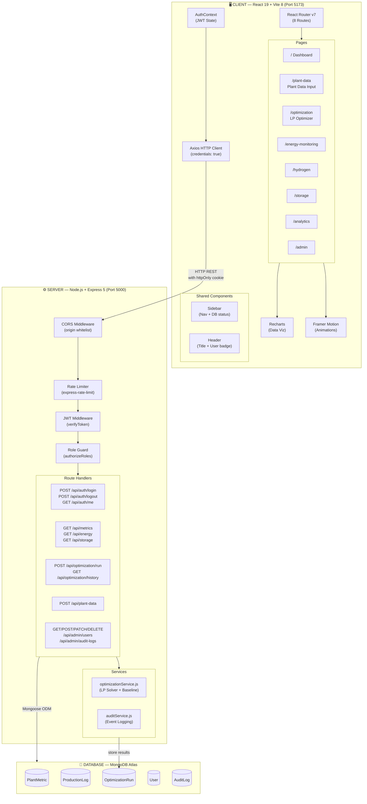

---

## Data Flow

### Request / Response Cycle

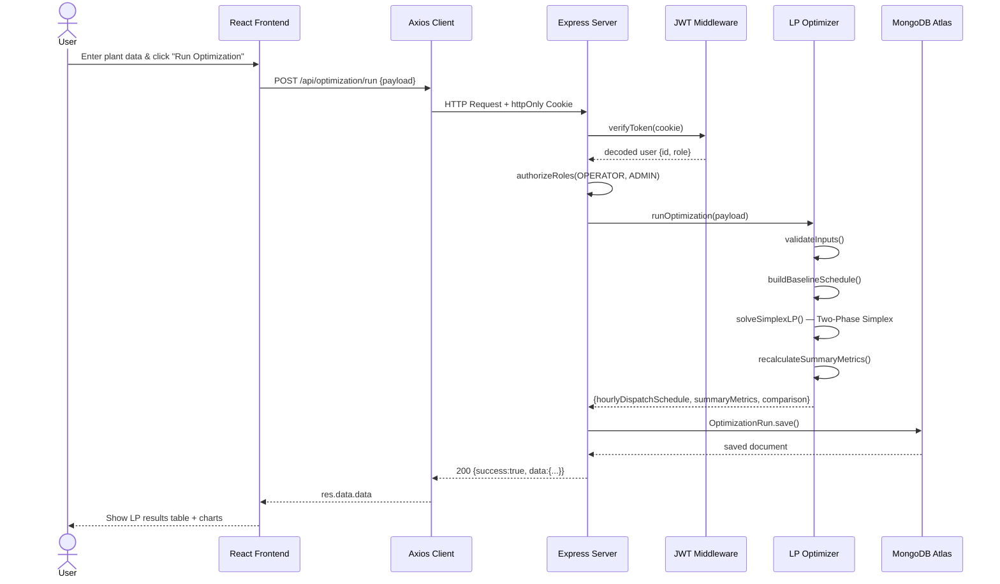

### Plant Data Input Flow

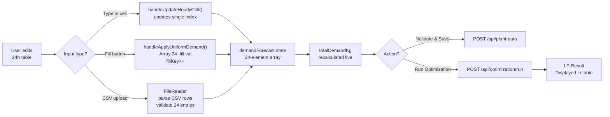

---

## Technology Stack

### Frontend

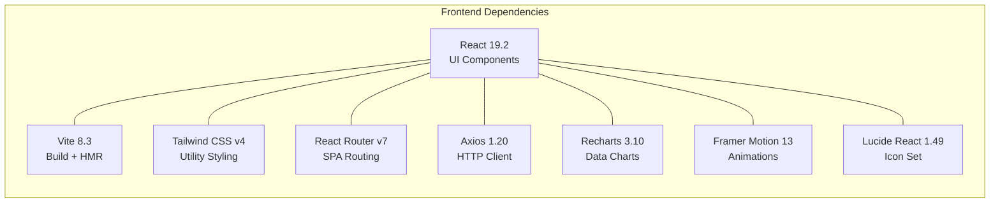

| Package | Version | Role |
|---|---|---|
| **React** | `^19.2.8` | Core UI component library |
| **Vite** | `^8.3.0` | Ultra-fast build tool & HMR dev server |
| **Tailwind CSS v4** | `^4.3.3` | Utility-first styling (`@tailwindcss/vite`) |
| **React Router DOM** | `^7.18.4` | Client-side SPA routing |
| **Axios** | `^1.20.0` | HTTP client with interceptors |
| **Recharts** | `^3.10.1` | Responsive chart components |
| **Framer Motion** | `^13.4.6` | Animations & micro-interactions |
| **Lucide React** | `^1.49.0` | Industrial icon library |

### Backend

| Package | Version | Role |
|---|---|---|
| **Node.js** | `>= 18.x` | JavaScript runtime |
| **Express** | `^5.2.1` | HTTP server & REST API framework |
| **Mongoose** | `^9.10.3` | MongoDB ODM with schema validation |
| **bcryptjs** | `^3.0.3` | Password hashing |
| **jsonwebtoken** | `^9.0.3` | JWT signing & verification |
| **cookie-parser** | `^1.4.7` | httpOnly JWT cookie handling |
| **express-rate-limit** | `^8.7.1` | Brute-force rate limiting |
| **cors** | `^2.8.6` | Origin-restricted CORS policy |
| **dotenv** | `^18.0.4` | `.env` environment loader |
| **nodemon** | `^3.1.14` | Dev hot-reload daemon |

---

## Repository Structure

```
Green-hydrogen-platform/
│
├── .gitignore                          ← excludes node_modules, .env, dist/
├── README.md
│
├── client/                             ── React Frontend SPA ──────────────
│   ├── index.html
│   ├── vite.config.js                  ← Vite + Tailwind plugin
│   ├── package.json
│   └── src/
│       ├── main.jsx                    ← React 19 root bootstrap
│       ├── App.jsx                     ← Routes, auth shell, global state
│       ├── api/
│       │   └── axios.js               ← Axios instance (baseURL, credentials)
│       ├── context/
│       │   └── AuthContext.jsx        ← JWT auth state provider
│       ├── components/
│       │   ├── Header.jsx
│       │   └── Sidebar.jsx
│       └── pages/
│           ├── LoginPage.jsx
│           ├── DashboardPage.jsx
│           ├── EnergyMonitoringPage.jsx
│           ├── HydrogenPage.jsx
│           ├── StoragePage.jsx
│           ├── OptimizationPage.jsx   ← LP results + scenario presets
│           ├── PlantDataInputPage.jsx ← 24h table, Fill, CSV, Run LP
│           ├── AnalyticsPage.jsx
│           ├── AdminPage.jsx
│           └── NotFoundPage.jsx
│
└── server/                             ── Express Backend ──────────────────
    ├── .env                            ← Secrets (gitignored)
    ├── package.json
    ├── server.js                       ← Entry: middleware, routes, DB connect
    ├── middleware/
    │   └── auth.js                    ← verifyToken, authorizeRoles
    ├── models/
    │   ├── User.js
    │   ├── PlantMetric.js
    │   ├── ProductionLog.js
    │   ├── OptimizationRun.js
    │   └── AuditLog.js
    ├── routes/
    │   ├── auth.js
    │   └── admin.js
    ├── services/
    │   ├── optimizationService.js     ← Two-Phase Simplex LP solver
    │   └── auditService.js
    ├── scripts/
    │   └── seedAdmin.js
    └── tests/
        └── runAuditTests.js
```

---

## LP Optimization Engine

### Algorithm Pipeline

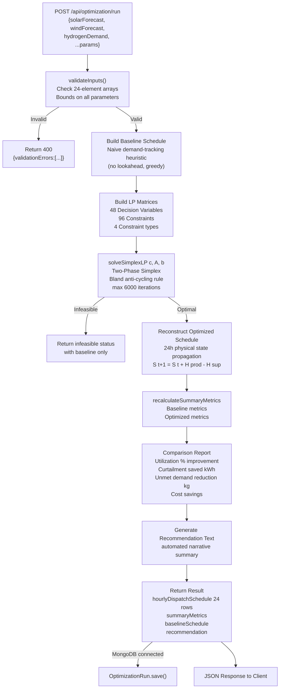

### Mathematical Formulation

**Decision Variables** (for each hour `t = 0 … 23`):

| Symbol | Description | Bounds |
|---|---|---|
| `P_t` | Electrolyzer power allocation (kW) | `0 ≤ P_t ≤ min(P_avail,t , P_max)` |
| `U_t` | Unmet hydrogen demand (kg) | `0 ≤ U_t ≤ D_t` |

**Physical Constraints:**

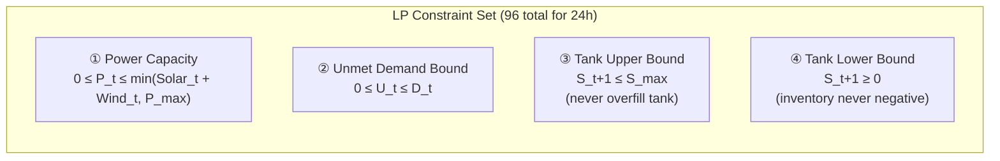

**Objective Function (Minimize):**

```
min Σ_{t=0}^{23} [ W_unmet × U_t  −  W_prod × (P_t / η)  +  price_t × P_t ]
                 − W_terminal × S_24

  W_unmet    = 10,000   (penalty: failing H₂ delivery)
  W_prod     = 100      (incentive: maximize green H₂)
  price_t    = $/kWh    (hourly grid electricity price)
  W_terminal = 5        (incentive: protective end-of-day buffer)
```

**State Equations:**

```
H_prod,t = P_t / η                        kg H₂ produced at hour t
H_sup,t  = D_t − U_t                      kg H₂ supplied to demand
S_{t+1}  = S_t + H_prod,t − H_sup,t      storage inventory update
P_curt,t = P_avail,t − P_t               curtailed renewable power
```

### Default Plant Parameters

| Parameter | Value |
|---|---|
| Max Electrolyzer Power (`P_max`) | 600 kW |
| Specific Energy Consumption (`η`) | 50 kWh/kg |
| Initial Storage (`S_0`) | 500 kg |
| Max Tank Capacity (`S_max`) | 1,000 kg |
| Peak Solar | 600 kW at 12:00 |
| Base Wind | 180–220 kW (diurnal) |
| H₂ Demand | 6–12 kg/h (diurnal profile) |

---

## Authentication & Role System

### JWT Auth Flow

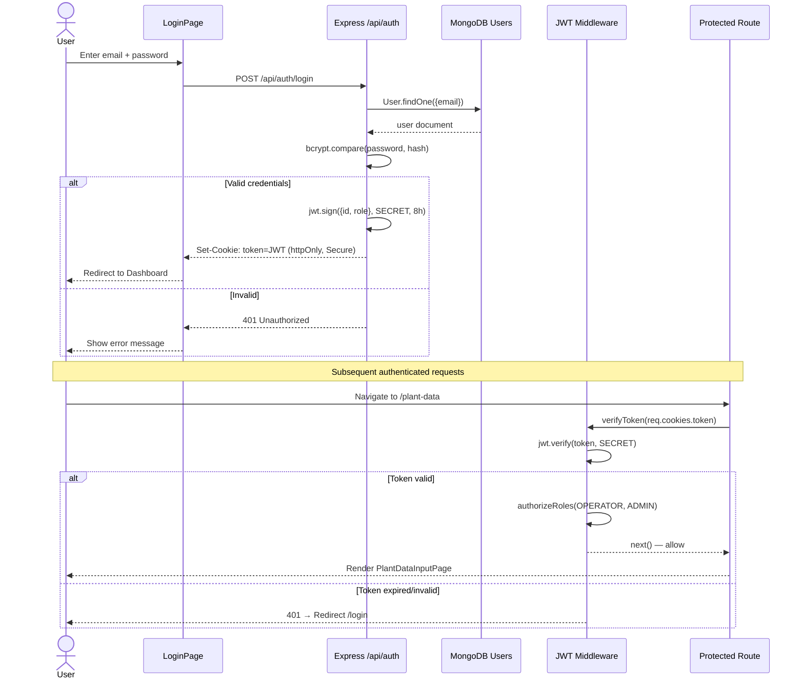

### Role-Based Access Control

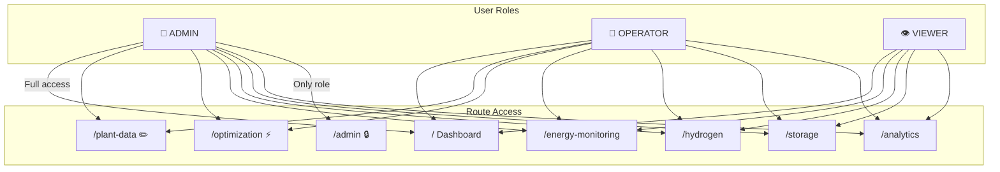

| Role | Dashboard | Plant Data | Run LP | Analytics | Admin Panel |
|---|---|---|---|---|---|
| **ADMIN** | ✅ | ✅ Read/Write | ✅ | ✅ | ✅ Full |
| **OPERATOR** | ✅ | ✅ Read/Write | ✅ | ✅ | ❌ |
| **VIEWER** | ✅ | ❌ Read-only | ❌ | ✅ | ❌ |

---

## API Reference

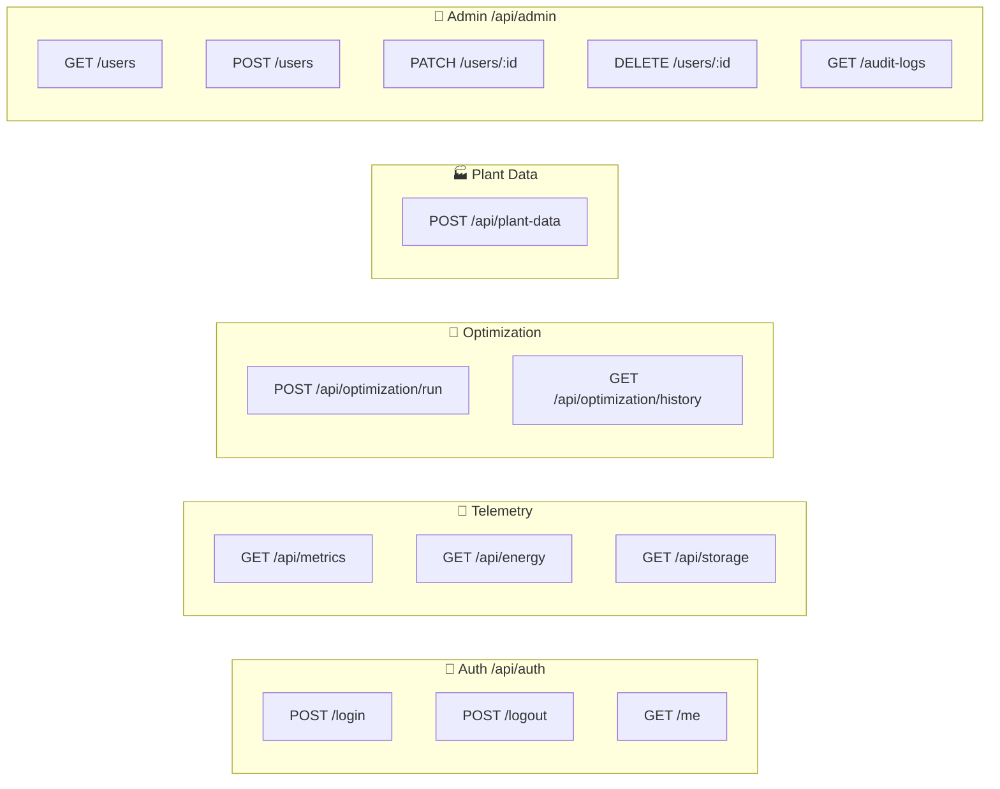

### Sample Optimization Payload

```json
POST /api/optimization/run
{
  "solarForecast":  [0,0,0,0,0,25,90,210,360,480,560,600,580,510,420,290,140,40,0,0,0,0,0,0],
  "windForecast":   [180,190,175,160,150,140,150,165,170,180,190,185,180,175,165,170,180,195,210,220,215,200,190,185],
  "hydrogenDemand": [8,8,8,8,8,8,8,8,8,8,8,8,8,8,8,8,8,8,8,8,8,8,8,8],
  "maxElectrolyzerPower": 600,
  "specificEnergyConsumption": 50,
  "initialStorageKg": 500,
  "maxStorageCapacityKg": 1000,
  "scenarioName": "Uniform 8 kg/h Demand Run"
}
```

---

## Frontend Pages

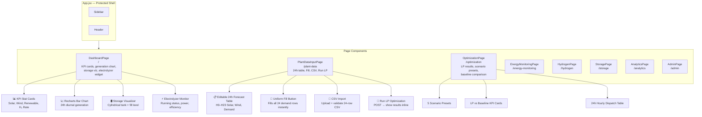

---

## MongoDB Data Models

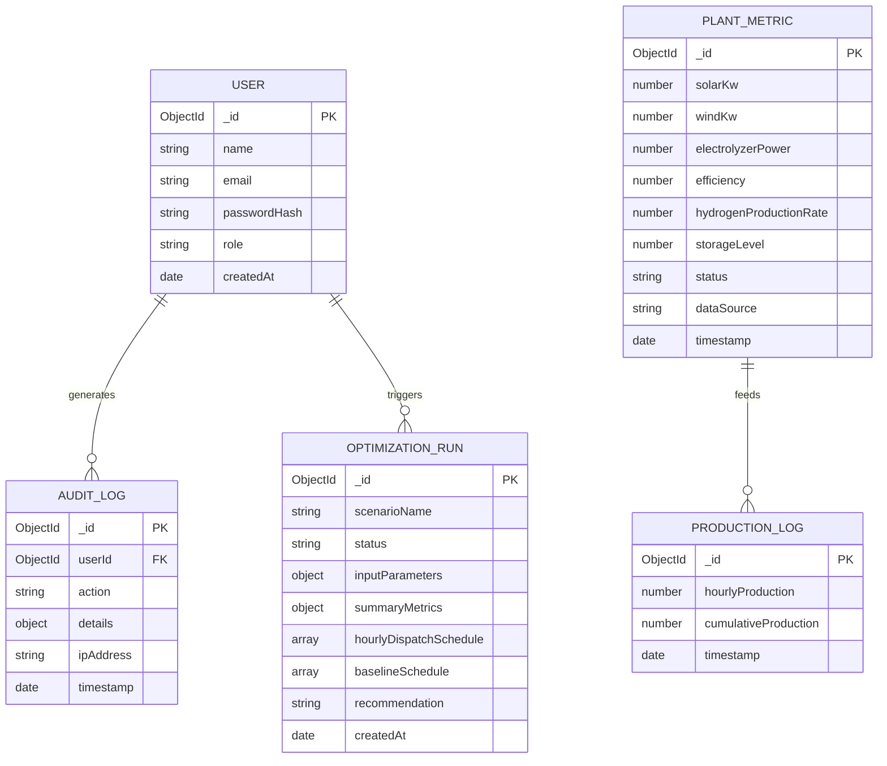

---

## Environment Configuration

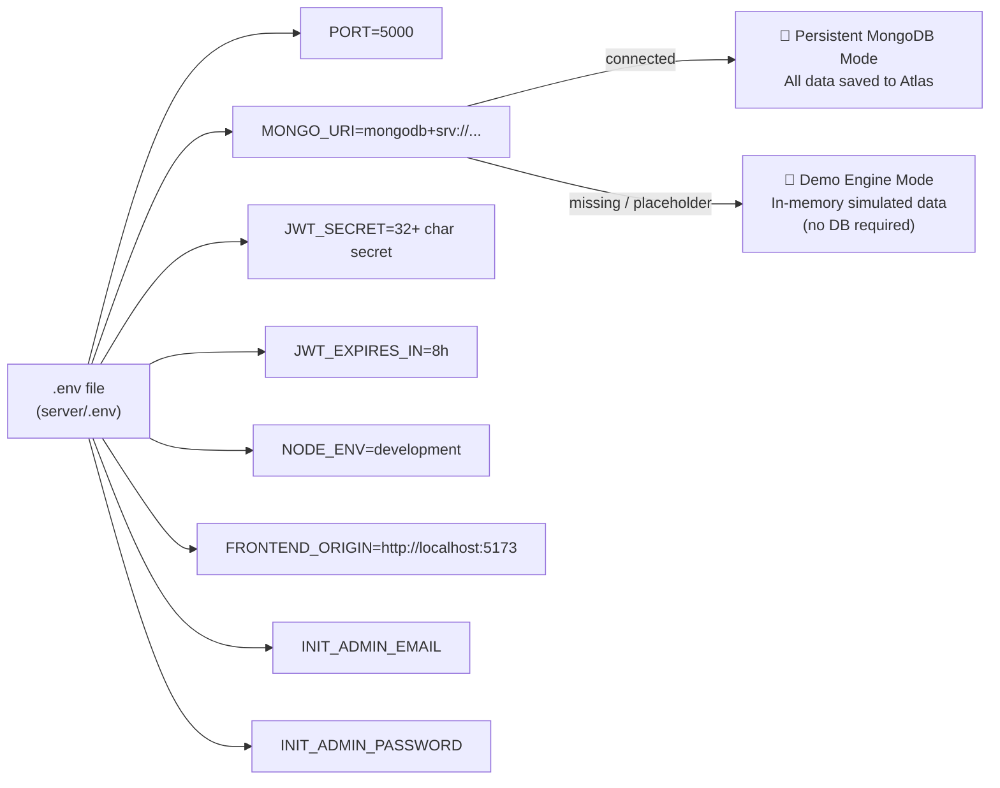

Create `server/.env`:

```ini
PORT=5000
NODE_ENV=development
MONGO_URI=mongodb+srv://<USER>:<PASSWORD>@<CLUSTER>.mongodb.net/greenhydrogen?retryWrites=true&w=majority
JWT_SECRET=replace-with-a-strong-random-secret-min-32-chars
JWT_EXPIRES_IN=8h
FRONTEND_ORIGIN=http://localhost:5173
INIT_ADMIN_EMAIL=admin@greenh2.local
INIT_ADMIN_PASSWORD=your-secure-password
INIT_ADMIN_NAME=System Administrator
```

> **Demo Mode:** If `MONGO_URI` is missing or uses placeholder credentials, the server automatically runs in full Demo Engine Mode — completely functional without a database.

---

## Getting Started

### Prerequisites
- Node.js `>= 18.x` · npm `>= 9.x`
- MongoDB Atlas account *(optional — runs in demo mode without it)*

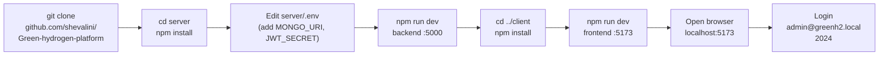

```bash
# 1. Clone
git clone https://github.com/shevalini/Green-hydrogen-platform.git
cd Green-hydrogen-platform

# 2. Backend
cd server
npm install
# edit .env with your secrets
npm run dev        # → http://localhost:5000

# 3. Frontend (new terminal)
cd client
npm install
npm run dev        # → http://localhost:5173
```

---

## Scenario Presets

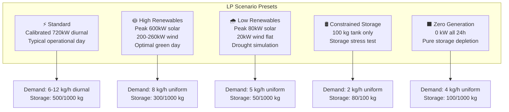

---

## Roadmap

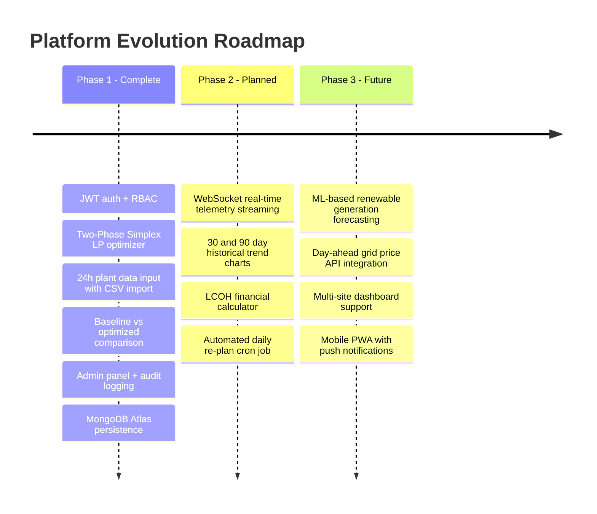

---

<div align="center">

Built with ⚡ renewable energy and ☕ by **shevalini**

</div>
