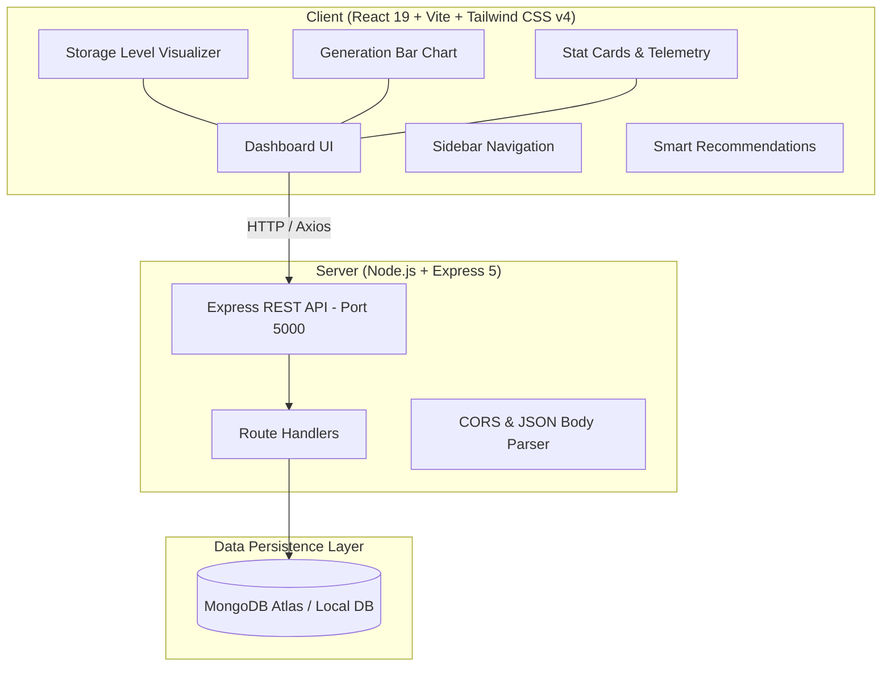
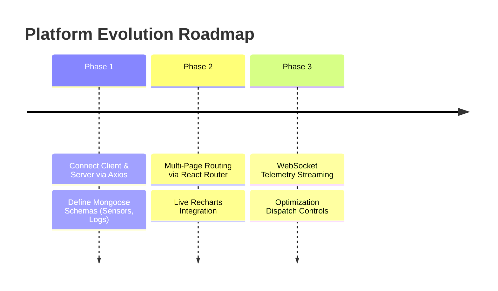

# Green Hydrogen Energy Platform — Comprehensive Project Documentation

---

## 1. Executive Summary

The **Green Hydrogen Energy Platform** is a digital supervisory control and monitoring dashboard designed for renewable-to-hydrogen production facilities. It unifies real-time telemetry from on-site renewable energy sources (solar arrays, wind turbines), electrolyzer operational units, and pressurized hydrogen storage facilities into a centralized interface.

The system empowers facility operators and energy engineers to:
- Monitor combined renewable energy generation against real-time demand.
- Track electrolyzer operational status, efficiency, and power consumption.
- Oversee hydrogen storage tank capacity and pressure levels.
- Receive algorithmic optimization recommendations to align production schedules with peak green power availability.

---

## 2. System Architecture

The project is structured as a decoupled full-stack application composed of a Vite-powered React client and a Node.js/Express backend service configured with MongoDB.



---

## 3. Directory & Repository Structure

```
Green-hydrogen-platform/
├── client/                               # Frontend single-page application
│   ├── public/                           # Static public assets (SVG icons, favicons)
│   ├── src/
│   │   ├── assets/                       # UI graphics and brand assets
│   │   ├── App.jsx                       # Main dashboard view and core subcomponents
│   │   ├── App.css                       # Layout helper styles
│   │   ├── index.css                     # Tailwind CSS v4 import & global typography
│   │   └── main.jsx                      # React 19 root bootstrap
│   ├── index.html                        # Application entry HTML
│   ├── package.json                      # Frontend dependencies & scripts
│   └── vite.config.js                    # Vite 8 config with Tailwind plugin
│
└── server/                               # Backend API microservice
    ├── .env                              # Environment variables (PORT, MONGO_URI)
    ├── package.json                      # Backend dependencies & npm scripts
    └── server.js                         # Express application initialization & routes
```

---

## 4. Technology Stack & Dependencies

### Frontend (`client/`)
| Technology | Version | Purpose |
| :--- | :--- | :--- |
| **React** | `^19.2.8` | Core UI library for component-driven UI |
| **Vite** | `^8.3.0` | Ultra-fast build tool and local development server |
| **Tailwind CSS** | `^4.3.3` | Utility-first styling framework (`@tailwindcss/vite`) |
| **Lucide React** | `^1.49.0` | Iconography suite for industrial & energy metrics |
| **Recharts** | `^3.10.1` | Advanced data visualization and chart generation |
| **Framer Motion** | `^13.4.6` | Smooth UI transitions and micro-animations |
| **React Router DOM**| `^7.18.4` | Client-side routing and multi-page view switching |
| **Axios** | `^1.20.0` | HTTP client for backend REST communication |

### Backend (`server/`)
| Technology | Version | Purpose |
| :--- | :--- | :--- |
| **Node.js** | `>= 18.x` (Tested: `v24.12.0`) | JavaScript runtime environment |
| **Express** | `^5.2.1` | Modern HTTP server and REST API framework |
| **Mongoose** | `^9.10.3` | Object Data Modeling (ODM) for MongoDB |
| **CORS** | `^2.8.6` | Cross-Origin Resource Sharing middleware |
| **Dotenv** | `^18.0.4` | Environment variable loader from `.env` |
| **Nodemon** | `^3.1.14` | Hot-reloading daemon for backend development |

---

## 5. Component Breakdown & UI Modules

The main frontend dashboard is implemented in [App.jsx](file:///c:/Users/shiva/OneDrive/Desktop/Green-hydrogen-platform/client/src/App.jsx) and comprises several key functional blocks:

### 5.1 Sidebar & Navigation
- **Branding**: Green H₂ Platform logo with droplet badge.
- **Navigation Links**:
  - `Dashboard` (Active)
  - `Energy Monitoring`
  - `Hydrogen`
  - `Storage`
  - `Optimization`
  - `Analytics`
  - `Settings`
- **System Health Indicator**: Live pulsing indicator confirming operational state.

### 5.2 Header Controls
- Plant control center title and operational status subtext.
- Notification bell with unread alert dot.
- Operator role badge (`Operator - Control Room`).

### 5.3 Live Metric Stat Cards (`StatCard`)
Four high-level KPI cards with trend indicators:
1. **Solar Energy**: `420 kW` (+12.4% today).
2. **Wind Energy**: `180 kW` (+6.8% today).
3. **Renewable Energy Total**: `600 kW` (82% utilized).
4. **Hydrogen Production Rate**: `18.4 kg/h` (Electrolyzer active).

### 5.4 Renewable Energy Generation Chart
- 12-interval diurnal generation bar chart representing solar and wind power output across a 24-hour cycle (06:00 to 21:00).
- Displays live peak capacity indicator (`720 kW`).

### 5.5 Hydrogen Storage Visualizer
- Graphical cylindrical tank representation with dynamic liquid-fill level indicator (`74%`).
- Detailed storage metrics:
  - Current storage: **740 kg**
  - Total capacity: **1,000 kg**
  - Available volume: **260 kg**

### 5.6 Industrial Electrolyzer Monitor
- **Operating Status**: Pulsing green badge (`RUNNING`).
- **Power Utilization**: Progress bar tracking load percentage (**78%**).
- **Sub-metrics**: Operating power (**550 kW**) and electrical conversion efficiency (**65%**).

### 5.7 Today's Production Trend
- Daily cumulative hydrogen yield: **142 kg** (+14.2% vs. previous day).
- Mini-histogram showing hourly generation ramp.

### 5.8 Smart Recommendation Engine Card
- Rule-based algorithmic optimization advise:
  > *"High renewable energy availability detected. Increase electrolyzer utilization to 550 kW for the next operating period."*
- Interactive trigger button to view full optimization dispatch plan.

---

## 6. Backend API & Configuration

The backend is initialized in [server.js](file:///c:/Users/shiva/OneDrive/Desktop/Green-hydrogen-platform/server/server.js).

### Current Endpoints
| HTTP Method | Endpoint | Description | Sample Response |
| :--- | :--- | :--- | :--- |
| `GET` | `/` | Health check & API verification | `{"message": "Green Hydrogen Platform API is running!", "status": "success"}` |

### Environment Configuration ([.env](file:///c:/Users/shiva/OneDrive/Desktop/Green-hydrogen-platform/server/.env))
```ini
PORT=5000
MONGO_URI=mongodb+srv://<USERNAME>:<PASSWORD>@green-hydrogen-cluster.meimsg.mongodb.net/green_hydrogen?retryWrites=true&w=majority
```

> [!NOTE]
> MongoDB driver `mongoose` is installed and ready. Providing valid credentials in [.env](file:///c:/Users/shiva/OneDrive/Desktop/Green-hydrogen-platform/server/.env) will enable active database syncing.

---

## 7. How to Run & Develop

### Prerequisites
- Node.js `v18+` (Tested on `v24.12.0`)
- npm `v9+` (Tested on `v11.6.2`)

### 1. Start the Backend Server
```bash
cd server
npm install    # (if running in a clean clone)
npm start      # runs 'node server.js' on http://localhost:5000
# or for live reloading:
npm run dev    # runs 'nodemon server.js'
```

### 2. Start the Frontend Client
```bash
cd client
npm install    # (if running in a clean clone)
npm run dev    # launches Vite dev server on http://localhost:5173
```

---

## 8. Recommended Next Steps & Roadmap



1. **Connect Frontend to Backend API**:
   - Replace static mock states in [App.jsx](file:///c:/Users/shiva/OneDrive/Desktop/Green-hydrogen-platform/client/src/App.jsx) with dynamic fetch calls via `axios` targeting `http://localhost:5000/api/...`.
2. **Implement MongoDB Schemas**:
   - `PlantMetric`: Store solar kW, wind kW, electrolyzer efficiency, and tank levels at 1-minute intervals.
   - `ProductionLog`: Historical hydrogen kg produced per day/month.
   - `OptimizationAlert`: AI / heuristic recommendations based on grid price and weather forecasts.
3. **Multi-page Navigation**:
   - Utilize `react-router-dom` to make the sidebar links route to dedicated sub-views (`/analytics`, `/storage`, `/optimization`, `/settings`).
4. **Live Telemetry & Real-time Updates**:
   - Integrate WebSockets (`socket.io`) or Server-Sent Events (SSE) for millisecond-level telemetry updates on electrolyzer temperature, pressure, and power spikes.
